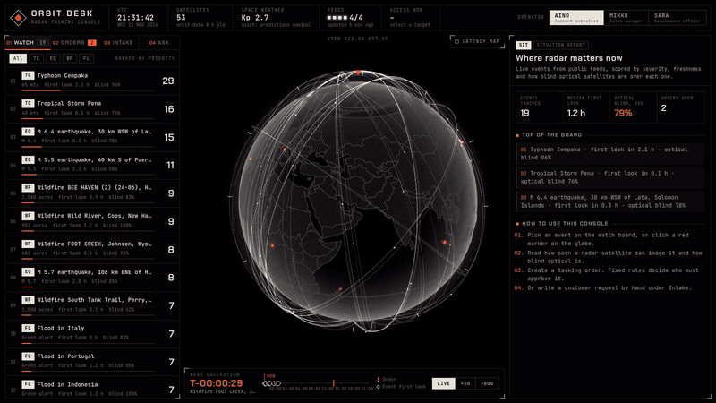

<!-- HERO -->
<p align="center">
  
</p>

<h1 align="center">
  
  &nbsp;orbit-desk
</h1>

<p align="center">
  <strong>Where in the world does radar imaging matter most right now, and how soon can we look?</strong>
</p>

<p align="center">
  <a href="#how-it-works"></a>
  <a href="#features"></a>
  <a href="#design-decisions"></a>
  <a href="#install"></a>
  <a href="LICENSE"></a>
</p>

<p align="center">
  <sub>A tasking console for a radar (SAR) satellite operator: live world events ranked by time to the first radar look and how blind optical satellites are there, turned into approved orders with a tamper-evident audit trail, on a 3D globe drawn from scratch.</sub>
</p>

<p align="center">
  <a href="docs/demo.mp4"></a>
  <br>
  <sub>10-second demo (<a href="docs/demo.mp4">MP4, 1600×900</a>): pick the top event and the globe flies to it with its countdown to the first radar look, time runs at ×600 so the satellites sweep past, then the latency map shows how soon any place on Earth can be imaged.</sub>
</p>

<p align="center"></p>

## What is this?

Radar satellites see through cloud and darkness, so they matter most exactly where
optical satellites are blind. Orbit Desk watches public event feeds, computes from
real orbits when a radar satellite can image each event, measures how blind optical
imaging is there, and ranks the events. One click turns an event into a tasking
order that goes through fixed approval rules, CRM and ticket writes, and a
hash-chained audit log.

- **Watch board:** earthquakes, floods, storms and wildfires, ranked by a transparent priority score
- **Time to first look:** SGP4 propagation of the 53 public ICEYE orbits, for every event
- **Optical blindness:** night from sun elevation, cloud from NOAA GFS whole-world forecasts
- **Latency map:** how soon any place on Earth can be imaged, on a 4° grid
- **Orders:** 7-day feasibility, a collection plan that avoids booked satellites, approvals, Jira and Slack
- **Analyst:** Claude answers questions through seven read-only tools and cannot approve anything

> [!NOTE]
> Independent portfolio project using only public data. Not affiliated with ICEYE.

<p align="center"></p>

## Features

**Watch board.** Earthquakes (USGS), disaster alerts and floods (GDACS), and storms
and wildfires (NASA EONET) are fetched every 10 minutes and merged, so an event
reported by two feeds appears once. Every event gets these numbers:

| Number | How it is computed |
|---|---|
| Time to first radar look | SGP4 propagation of 53 public orbits (CelesTrak) |
| Looks in 24 h and 72 h | The same propagation, shared by all events |
| Optical-blind share | Hours of night or at least 70% cloud (NOAA GFS forecast) |
| People nearby | Population of cities within 100 km (bundled GeoNames list) |
| Priority | Severity × radar advantage × freshness × people nearby, each term shown with its source |

<table>
<tr>
<td width="50%" valign="top">

**Event dossier**<br>A live countdown to the first look, one time axis showing night, cloud and every radar pass, and the full priority calculation.

</td>
<td width="50%" valign="top">

**Latency map**<br>The whole globe coloured by the wait for a first radar look over 24 hours. Gaps between orbits show as orange bands; hover any point for its wait and looks.

</td>
</tr>
<tr>
<td width="50%" valign="top">

**Tasking orders**<br>From an event or a plain-language request: 7-day feasibility, a collection plan that skips booked satellites, a brief, and a Capella/Umbra revisit comparison.

</td>
<td width="50%" valign="top">

**Approvals and audit**<br>A sales manager signs every order; restricted countries also need compliance. Nobody approves their own request, and every step goes to a hash-chained log.

</td>
</tr>
<tr>
<td width="50%" valign="top">

**Integrations**<br>On approval: a Jira ticket (real when configured) and a simulated Salesforce deal. Writes are idempotent; a failed one is logged and can be retried. Slack alerts.

</td>
<td width="50%" valign="top">

**Analyst**<br>Claude answers questions like "which floods can we image before 06:00 UTC?" with seven read-only tools, and drafts outreach from an event's facts. Nothing is sent.

</td>
</tr>
<tr>
<td width="50%" valign="top">

**Globe**<br>Drawn from scratch with three.js: painted borders, dotted land, a day/night line, satellites on real orbits, ground tracks, and live links to satellites in view.

</td>
<td width="50%" valign="top">

**Private by design**<br>No target location leaves the app: cloud data is downloaded as whole-world files, and cities and borders are bundled. Everything runs offline with one setting.

</td>
</tr>
</table>

<p align="center"></p>

## How it works

```text
 PUBLIC FEEDS (every 10 min)              ORBITS (CelesTrak, cached 6 h)
 USGS · GDACS · NASA EONET                53 TLEs ──▶ SGP4 ephemeris, 7 days
 NOAA GFS cloud (whole-world files)            │      computed once, reused for
 NOAA SWPC space weather                       │      every target
          │                                    │
          ▼                                    ▼
 ┌─────────────────┐   ┌──────────────────────────────────────────┐
 │ Fuse + dedupe   │──▶│ Per event: passes (15°–45° incidence),   │
 │ events          │   │ night + cloud blindness, people nearby,  │
 └─────────────────┘   │ priority score with every term explained │
                       └────────────────────┬─────────────────────┘
                                            │            ┌────────────────────┐
                                            │            │ Latency map:       │
                                            │            │ 4,050 grid cells,  │
                                            ▼            │ first look + looks │
 ┌──────────────┐   ┌──────────────────────────────┐     └────────────────────┘
 │ Free text or │──▶│ Tasking order                │
 │ one click    │   │ feasibility · collection plan│
 └──────────────┘   │ avoiding booked satellites   │
  (Claude parser    └───────────────┬──────────────┘
   or rule-based)                   ▼
                    ┌──────────────────────────────┐
                    │ Approval rules (coordinates  │──▶ Jira ticket · CRM deal
                    │ only) · sales · compliance   │──▶ Slack message
                    └───────────────┬──────────────┘
                                    ▼
                    ┌──────────────────────────────┐
                    │ Hash-chained audit log       │
                    └──────────────────────────────┘
```

<p align="center"></p>

## Install

**Option 1: Docker (recommended).** Only Docker is needed.

```bash
cp .env.example .env      # optional: add ANTHROPIC_API_KEY to use Claude
make up                   # builds one image and starts it with PostgreSQL
# open http://localhost:8000
```

**Option 2: keys for more features.** The app runs with no keys at all. Each
key in `.env` switches on one more capability; [KEYS.md](KEYS.md) says where each
one comes from.

| Key | Unlocks |
|---|---|
| `ANTHROPIC_API_KEY` | Claude reads free-text requests, the analyst and outreach drafts |
| `JIRA_BASE_URL`, `JIRA_EMAIL`, `JIRA_API_TOKEN`, `JIRA_PROJECT_KEY` | Real Jira tickets on approval |
| `SLACK_WEBHOOK_URL` | Slack messages for orders, decisions and high-priority events |
| `INTEL_ENABLED=false` | Turns all public feeds off and runs fully offline |

**Verify**

```bash
make test                                         # 24 backend tests
curl -s localhost:8000/api/health                 # {"ok": true}
curl -s "localhost:8000/api/coverage/at?lat=60.17&lon=24.94"   # wait for a look at Helsinki
```

<p align="center"></p>

## Usage

<details>
<summary><strong>Try the injection test</strong>: the AI can suggest, but it cannot decide</summary>

<br>

Open **Intake** and pick "Injection test". The text claims the order is
pre-approved and tells the system to skip the review. Approval rules look only at
where the coordinates fall, so the order is still held for compliance, and the
refused approval attempt is logged.

</details>

<details>
<summary><strong>Watch board and events API</strong></summary>

<br>

| Method | Path | Returns |
|---|---|---|
| `GET` | `/api/intel/watch` | Ranked events, feed status, space weather |
| `GET` | `/api/intel/events/{id}/brief` | Markdown brief for one event |
| `POST` | `/api/intel/events/{id}/draft` | Outreach draft for an audience (not sent) |

</details>

<details>
<summary><strong>Latency map API</strong></summary>

<br>

| Method | Path | Returns |
|---|---|---|
| `GET` | `/api/coverage` | Hours to first look and looks per cell, 4° grid, plus area-weighted stats |
| `GET` | `/api/coverage/at?lat=&lon=` | One cell: hours to first look, looks in 24 h |

</details>

<details>
<summary><strong>Orders, approvals and audit API</strong></summary>

<br>

| Method | Path | Does |
|---|---|---|
| `POST` | `/api/requests` | Create an order from plain text |
| `POST` | `/api/requests/from-event/{id}` | Create an order from an event (one per open event) |
| `GET` | `/api/requests`, `/api/requests/{id}` | List or read orders |
| `GET` | `/api/requests/{id}/brief` | Markdown brief for an order |
| `POST` | `/api/requests/{id}/decision` | Approve or reject (role checked) |
| `POST` | `/api/requests/{id}/sync` | Retry a failed Jira or CRM write |
| `GET` | `/api/audit`, `/api/audit/verify` | Audit log and chain check |

Sign-in is a demo switcher: the `X-Demo-User` header picks the operator
(account executive, sales manager or compliance officer).

</details>

<details>
<summary><strong>Analyst API</strong></summary>

<br>

`POST /api/agent/ask` with `{"question": "...", "history": [], "context": null}`.
Tools: `list_events`, `get_event`, `find_place`, `passes_for_location`,
`people_nearby`, `list_orders`, `get_order`. All read-only; the loop is capped.

</details>

<p align="center"></p>

## Design decisions

1. **The AI suggests; fixed rules decide.** Approvals depend only on coordinates and roles, never on what a request's text says.
2. **No target location leaves the app.** Cloud data is downloaded as whole-world files and looked up locally; cities and country checks use bundled data. The only thing sent to Anthropic is a typed request's text, when a key is set.
3. **One ephemeris, many targets.** Orbits are propagated once per window and reused for every event, order and grid cell, which is what makes a 4,050-cell world map take seconds.
4. **Every number shows its source.** The priority score lists each term and where it came from, so an operator can disagree with it.
5. **Area-weighted statistics.** A grid cell near the pole covers far less ground than one at the equator, so latency figures weight by area.
6. **Writes are idempotent and failures are visible.** A failed Jira or CRM write leaves the order approved, logs the error and offers a retry.
7. **Tamper-evident by default.** Each audit entry hashes the one before it, so an edit or deletion is detectable.
8. **Cross-checked geometry.** Pass geometry was compared with a second SGP4 library (satellite.js): 293 passes agreed within 0.7° of incidence angle, and a test checks every latency-map cell against the single-target pass search.

<details>
<summary><strong>Honest limits</strong></summary>

<br>

- **Feasibility is a simplified model.** A look counts when a satellite's closest approach has an incidence angle between 15° and 45°. These are assumptions, not vendor specifications. Every satellite is treated as working and free; the constellation comparison shows orbit geometry only, not capacity.
- **"Optical blind" is an estimate:** night from sun elevation, cloud from a forecast with a fixed 70% threshold, on a 1° grid (about 100 km) every 3 to 6 hours.
- **Priority is a transparent heuristic**, not a validated model. Severity scales differ by event type.
- **People nearby counts cities above 15,000 only**, so rural areas read as zero.
- **Conflict avoidance is simple:** one satellite cannot serve two orders within 10 minutes. It is not a full scheduler.
- **Salesforce is simulated**, Jira is simulated unless configured, and sign-in is a demo switcher.
- **The restricted-country list is an example**, not legal advice.

</details>

<p align="center"></p>

## Stack

| Part | Choice |
|---|---|
| API | Python, FastAPI, SQLAlchemy 2, Alembic |
| Database | PostgreSQL, tables in a dedicated `orbitdesk` schema |
| Orbit maths | `sgp4` + NumPy, one ephemeris reused for every target |
| AI | Claude through the Anthropic SDK, structured output |
| Dashboard | TypeScript, React, Vite, three.js, satellite.js |
| Packaging | One multi-stage Docker image, Docker Compose |

<p align="center"></p>

## Project layout

```text
orbit-desk/
├── backend/
│   ├── app/
│   │   ├── orbits.py       orbit data, ephemeris, pass search, sun elevation
│   │   ├── coverage.py     worldwide latency map, area-weighted stats
│   │   ├── osint.py        event feeds, fusion, space weather
│   │   ├── cloud.py        NOAA GFS cloud forecast, whole-world download
│   │   ├── watch.py        watch board: optical profile, priority score
│   │   ├── geo.py          offline city database: people nearby, geocoding
│   │   ├── parser.py       Claude parser and rule-based fallback
│   │   ├── policy.py       approval rules, country lookup
│   │   ├── agent.py        analyst: tools, capped loop, outreach drafts
│   │   ├── connectors.py   Jira, Salesforce (simulated), Slack
│   │   ├── briefs.py       Markdown briefs for events and orders
│   │   ├── audit.py        hash-chained audit log
│   │   └── main.py         API and workflow
│   ├── alembic/            database migrations
│   └── tests/              24 tests
├── frontend/src/
│   ├── globe/              three.js globe, shaders, overlay
│   └── components/         dossiers, latency panel, visibility strip, timeline
├── docs/                   demo video and GIF
├── assets/                 README images
├── Dockerfile · docker-compose.yml · Makefile
└── KEYS.md                 optional keys and where to get them
```

City data from GeoNames (CC BY 4.0). Borders from Natural Earth (public domain).
Orbits from CelesTrak.

<p align="center"></p>

<p align="center"><sub>MIT License © 2026 Md Mahbub Islam</sub></p>
